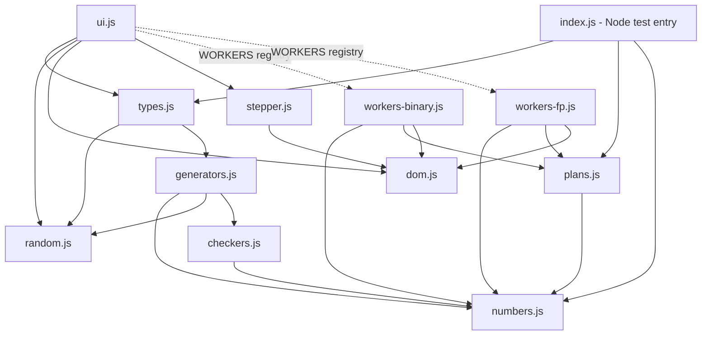

# Hexercise `js/` code map

Quick-reference for editing the JS modules. Every module is an IIFE that reads/writes the shared global namespace `globalThis.Hex`. Each module ends with `Hex.name = name;` exports. Under Node, modules `require()` their dependencies; in the browser, load order in [index.html](../index.html#L67-L77) does that job.

## 1. Module dependency graph

Arrow = "uses symbols exported by".

Layers: **pure maths** (random, numbers, checkers, plans) → **content** (generators, types) → **DOM/UI** (dom, stepper, workers-*, ui). Pure modules never touch `document`, so `index.js` can load them in Node.

Browser load order (index.html): random, numbers, checkers, generators, types, plans, dom, stepper, workers-fp, workers-binary, ui.

## 2. Function index by module

### random.js — seeded RNG
| Export | Signature | Notes |
|---|---|---|
| `Hex.hashSeed` | `(s) → uint32` | FNV-1a of trimmed string |
| `Hex.mulberry32` | `(seed) → r()` | `r()` returns float in [0,1) |
| `Hex.ri` | `(r, a, b) → int` | inclusive range |
| `Hex.pick` | `(r, arr) → item` | |

### numbers.js — value/string helpers
| Export | Signature | Notes |
|---|---|---|
| `Hex.P` | `(n) → 2^n` | |
| `Hex.toBin` | `(n, w) → string` | left-pads to width `w` |
| `Hex.toHex` | `(n) → string` | uppercase, no prefix |
| `Hex.tcStr` | `(n, w) → string` | two's complement bit string |
| `Hex.tcVal` | `(bitstr) → int` | inverse of `tcStr` |
| `Hex.inv` | `(bitstr) → bitstr` | flips every bit |
| `Hex.fpVal` | `(m, e, M) → number` | `m * 2^(e-(M-1))` |
| `Hex.bold` | `(x) → '<b>x</b>'` | |

### checkers.js — answer checking
| Export | Signature | Notes |
|---|---|---|
| `Hex.clean` | `(s) → string` | trims, strips whitespace and `_` |
| `Hex.chk.str` | `(exp) → check(s)` | exact string; strips `0b` |
| `Hex.chk.binVal` | `(v) → check(s)` | binary string equal to int `v` |
| `Hex.chk.dec` | `(v) → check(s)` | signed integer |
| `Hex.chk.hex` | `(v) → check(s)` | strips `0x` |
| `Hex.chk.real` | `(v) → check(s)` | decimal, exact match |
| `Hex.chk.binFrac` | `(v) → check(s)` | `101.011` style, tolerance 1e-12 |
| `Hex.Q` | `(html, answer, check, extra) → question` | question factory, see §3 |

### generators.js — one generator per question type (`g*(r) → question`)
| Function | Question `meta.kind` | Helpers used |
|---|---|---|
| `gBinWhole` | none | |
| `gBinAdd` | `binadd` | |
| `gBinSub` | `binsub` | |
| `gBinMul` | none | |
| `gHexDen` / `gHexDenAdv` | none | private `hexDen(r, lo, hi)` |
| `gHexBin` / `gHexBinAdv` | none | |
| `gTwos` | `twos` (k = 0, 1, 2) | |
| `gBinFrac` | none | |
| `gReal` | `fpval` (k0), `fprep` (k1), `fpnorm` (k2) | `normMant`, `fpIntro`, `FP` table |
| `gFpAdd` | `fpadd` | `normMant`, `fpNormalise(m,e,M,E)`, `fpIntro`; falls back to `gReal` |

Private (not exported): `hexDen`, `normMant`, `fpIntro`, `fpNormalise`, const `FP` (`[M,E]` pairs).

### types.js — registry
| Export | Notes |
|---|---|
| `Hex.TYPES` | array of `{id, name, lv[], gen}`; ids: binwhole, binadd, binsub, binmul, hexden, hexdenadv, hexbin, hexbinadv, twos, binfrac, real, fpadd |
| `Hex.generateSet(seed, n, ids)` | shuffled "bag" draw over ticked types, then `Object.assign(gen(r), {type: id})` |

### plans.js — pure working-out maths
| Export | Signature | Notes |
|---|---|---|
| `Hex.addCols` | `(x, y) → {carries, sum, carryOut}` | equal-length bit strings, `carries[j]` is carry INTO column j |
| `Hex.fpAddPlan` | `(meta, answer) → plan` | plan: `{M,E,sub,mA,eA,mB,eB,d,bPad,nm,ne}` |
| `Hex.fpMove` | `(plan, who, dir, places, newExp, dirB, placesB) → {who,dir,places,dirB,placesB,exp,Ec}` | `who` is `'A'`, `'B'`, `'both'` (both points moved so both exponents are 0) or `'none'`. Each result field is true/false. `places`/`newExp`/`placesB` are numbers, `null` for blank, `NaN` for junk. `'none'` is only right when exponents already match and accepts blank places/exponent. `Ec` = the common exponent chosen |
| `Hex.fpFrame` | `(plan, Ec) → {I,F,W,Ec,L,R,a,b,op2,sum,va,vb,vo,vs}` | fixed-point frame for the add steps; `L`/`R` = boxes before/after the point (at least M−1 each); `a/b` = A and B as frame bit strings (`va/vb` their values); `op2/vo` = the second operand (−B when subtracting); `sum/vs` the result |
| `Hex.readFixed` | `(cells, L) → {ok,value}` | reads a row of boxes as a two's complement fixed-point value; leftmost typed box is the sign bit; gaps → not ok |
| `Hex.judgeFixedRow` | `(cells, L, expected) → [true/false/null…]` | value-based marking, so padding is optional; blank boxes are `null` (neutral) |
| `Hex.judgeCarryRow` | `(cells, expected, sumCells) → […]` | typed carries must match; a blank is wrong only if a carry is needed inside the columns typed in the sum |

### dom.js — DOM helpers and field builders
| Export | Signature | Notes |
|---|---|---|
| `Hex.el` | `(id)` | `getElementById` |
| `Hex.esc` | `(s)` | escapes `&` and `<` |
| `Hex.mk` | `(tag, cls, html)` | create element |
| `Hex.normInt` | `(s) → number or NaN` | accepts unicode minus |
| `Hex.textBox` | `(cls) → input` | |
| `Hex.bitField` | `(el, ans, opt) → field` | `opt` allows blank when answer is `'0'` |
| `Hex.numField` | `(el, ans) → field` | integer compare |
| `Hex.bitRow` | `(label, bits, I, fields, o)` | `o`: `line, nopt, wide, skipLast, cy, opt, rtl, first`; `fields` omitted → static grey bits; `I` = index where the point is drawn. `rtl` = student types right to left (`data-rtl`); `first` = first box in entry order gets initial focus (`data-first`). Every input has `data-col` for ↑/↓ |
| `Hex.fixedRow` | `(label, g, bits, fields, o)` | row of `g.L + g.R` boxes around a point, `g = {L,R,I,F}`; a space in `bits` = empty box; `o`: `line, rtl, cy, opt, focusCol`. Judged as a whole via `judgeFixedRow`/`judgeCarryRow` |
| `Hex.addBlock` | `(body, fields, o)` | standard column addition: carries row, two operand rows, sum row (right-to-left, focus on the sum LSB). `o`: `x,y,carries,sum,I,xl,yl,sl` |
| `Hex.numRow` | `(label, ans, fields, unit)` | |
| `Hex.txtRow` | `(label, ans, fields)` | exact string, whitespace ignored |
| `Hex.valRow` | `(label, arr, fields)` | row of wide numeric boxes |
| `Hex.mkSel` | `(label, opts[[val,text]])` | `<select>` |

### stepper.js — step controller
| Export | Notes |
|---|---|
| `Hex.stepper(host) → add(spec)` | Attaches delegated `input`/`keydown` handlers (bit-box auto-advance in entry order — leftwards for `data-rtl` rows; ←/→ physical; ↑/↓ between rows with the same `data-col` (carries ↔ sum); backspace; Enter = Check). A judged box that comes back `null` stays uncoloured; the next step focuses `[data-first]`. `add(spec)` appends a step; wires Check and "Fill in" buttons. Returns the step element. |

### workers-binary.js — `Hex.WORKERS.*(q, add)`
| Worker | Steps (each a nested `add()` via `after`) |
|---|---|
| `binadd` | 1 step: carries and sum (`addBlock`) |
| `binsub` | flip B → add 1 (with carries, local `addOne`) → add A and −B (with carries) |
| `twos` | k=0: positive binary → (flipAdd); k=1: place values → add up; k=2: flipAdd. Local helper `flipAdd(start, last)` |

### workers-fp.js
| Worker | Steps |
|---|---|
| `fpadd` | `add(...)` exponents → `step2` match exponents (boxes: who, dir, places, dirB, placesB, exp; 'neither' auto-fills 0 and the exponent and may be left blank; 'both' = fixed point, exponent 0) → `step3` align points (student writes A and B in the common-exponent frame) → `step4` two's complement of B in that frame: flip, carries, +1, −B (only if subtracting) → `step5` add → `step6` normalise → `step7` final answer. Shared state: `pl` (plan), `fr` (frame, set in step 2's `after`). Align/Add rows are `fixedRow`s: padding optional, add rows typed right to left. Steps 4–6 draw the grey rows with the fewest bits that hold the values (local `minInt`/`minFrac`): operands share an integer width, the sum gets one more, trailing fraction zeros are dropped, and Normalise shows the sum minimally. |

### ui.js — page wiring (returns early if `document` is undefined)
| Function | Role |
|---|---|
| `buildTable()` | builds the type checkbox table and the `[data-level]` preset buttons |
| `selectedIds()` | ticked type ids |
| `showMsg(text)` | `#msg` banner |
| `render(qs, code)` | renders the question list; wires Check/Enter per question; calls `wireWork` |
| `buildWork(q, root, d)` | builds the working-out panel via `WORKERS[q.meta.kind](q, stepper(steps))`; "Start again"/"Hide" |
| `wireWork(d, q)` | open/close toggle — **only the question number** opens it (Enter/Space too); focuses `[data-first]` on open; no-op unless a worker exists |
| `writeHash(code, n, ids, written)` | `history.replaceState` with `c`, `n`, `t`, `w` |
| `refresh()` | read controls → `generateSet` → `render` → `writeHash` |
| `loadFromHash()` | restores state from the URL hash; returns true if any type selected |
| `init()` | binds events, auto-refreshes if hash present |

## 3. Data contracts

**Question** (from `Q()`): `{ html, answer: String, check(str)→bool, prefix: '' , meta?, type }`. `type` is added by `generateSet`. `meta.kind` selects a worker in `WORKERS`.

**Meta shapes by kind**
- `binadd` / `binsub`: `{a, b, bits}`
- `twos`: `{k:0, n, bits}` | `{k:1, m, bits}` | `{k:2, a, bits}`
- `fpval`: `{M, E, mant, exp, value}` (no worker yet)
- `fprep`: `{M, E, value}` (no worker yet)
- `fpnorm`: `{M, E, mant, exp}` (no worker yet)
- `fpadd`: `{M, E, op:'+'|'-', A:[mant,exp], B:[mant,exp]}`

**Field** (returned in arrays by `build`): `{ el, ans: String, ok(v)→bool, opt? }`. fpadd step 2 has six fields (who, dir, places, dirB, placesB, exp) judged by `spec.judge`; align/add rows are judged per row by `spec.judge` (`null` = unused box).

**Step spec** (`add(spec)`): `{ title, help, build(bodyEl) → fields[], judge?(values[]) → (true|false|null)[], after?(values), finish? }`. `after` runs when the step is solved; it normally calls `add()` for the next step.

## 4. "Where do I change X?" cheatsheet

| Task | Touch |
|---|---|
| New question type | `generators.js` (add `gX`, export) → `types.js` (destructure and add a `TYPES` entry) → optionally a checker in `checkers.js` |
| Add working-out to an existing type | Make the generator emit `meta: {kind:'foo', ...}`, then add `WORKERS.foo` in `workers-binary.js` or `workers-fp.js` (or a new file plus a `<script>` tag before `ui.js`). Pure maths belongs in `plans.js` (testable in Node via `index.js`). |
| New form control | `dom.js` (export it, then destructure it in the worker file) |
| Change step behaviour (keys, Check/Fill) | `stepper.js` |
| Change page layout/URL hash/controls | `ui.js` (`render`, `writeHash`, `loadFromHash`) |
| Change answer acceptance rules | `checkers.js` (`chk.*`) |
| Change seed to question mapping | `random.js` or `types.js:generateSet` (this alters existing question codes!) |
| Expose more for Node tests | `index.js` re-export list |

## 5. Gotchas

- **Adding a new file**: add a `<script>` tag in `index.html` in dependency order, and a `require()` line inside the module for Node.
- **Dependencies are copied at load time** (`var x = Hex.x`), so the dependency must be loaded first and later reassignment of `Hex.x` is not seen.
- **Seed stability**: changing the number or order of `r()` calls in any generator, or the `TYPES` order, changes which questions existing codes produce.
- `workers-*.js` and `ui.js` use `WORKERS = Hex.WORKERS = Hex.WORKERS || {}`; any of them may create the registry first.
- `index.js` only loads `types`, `plans`, `numbers` (types pulls in random/generators/checkers). The DOM modules are never loaded in Node.
- Types without `meta.kind` workers (`binmul`, `fpval`, `fprep`, `fpnorm`, hex/denary, etc.) simply have no working-out panel.
- `Hex.clean`, `Hex.bitField` and `Hex.numField` are exported but only used inside their own modules.
- In `fixedRow`, a **space** in `bits` means an empty box; a `0` is a real bit.
- Rows that can be partly filled must be judged with `judgeFixedRow`/`judgeCarryRow`, not per-box `ok`, otherwise unused padding boxes would be marked wrong.
